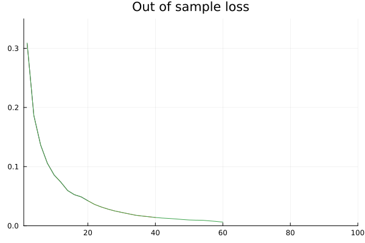

```@meta
EditURL = "notebook.jl"
```

# Wrapping a Tree Booster in Iteration Controls

> A demonstration of wrapping a gradient tree boosting model in
> [MLJ](https://juliaml.ai)'s `IteratedModel` model wrapper

````@julia
using MLJBase, MLJIteration, StatisticalMeasures # or just `using MLJ`
import IterationControl
using Dates
import DataFrames.DataFrame
import EvoTrees.EvoTreeClassifier
using Plots
using Statistics
using Random
Random.seed!(123)
````

````
Random.TaskLocalRNG()
````

Load some synthetic training data:

````@julia
X, y = make_moons(1000, rng=123); # a table and a vector
````

Instantiate a model:

````@julia
model = EvoTreeClassifier(rng=123, colsample=0.5)
````

````
EvoTreeClassifier(
  loss = :mlogloss, 
  metric = :mlogloss, 
  nrounds = 100, 
  bagging_size = 1, 
  early_stopping_rounds = 9223372036854775807, 
  early_stopping_tolerance = 0.0, 
  L2 = 1.0, 
  lambda = 0.0, 
  gamma = 0.0, 
  eta = 0.1, 
  max_depth = 6, 
  min_weight = 1.0, 
  rowsample = 1.0, 
  colsample = 0.5, 
  nbins = 64, 
  tree_type = :binary, 
  seed = 123, 
  device = :cpu)
````

Define a callback for plotting:

````@julia
iterations = Int[0]
losses = Float64[0]
plt = plot(; xlim=[1,100], ylim=[0,0.35], title="Out of sample loss", legend=false)


function update_plot()
    plot!(
        iterations[2:end],
        losses[2:end],
    ) |> display
    sleep(0.5) # for demo only
end;
````

Wrap the booster in iteration controls:

````@julia
imodel = IteratedModel(
    model,
    resampling=Holdout(rng=123),
    measures=[brier_loss, log_loss],
    iteration_parameter=:nrounds,
    controls=[
        Step(2),
        WithIterationsDo(i->(push!(iterations, i); i)),
        WithLossDo(l->(push!(losses, l); l)),
        IterationControl.skip(Callback(_->update_plot()), predicate=10),
        NumberSinceBest(3),
        GL(0.5),
        TimeLimit(Second(30)),
    ],
)
````

````
ProbabilisticIteratedModel(
  model = EvoTreeClassifier(
        loss = :mlogloss, 
        metric = :mlogloss, 
        nrounds = 100, 
        bagging_size = 1, 
        early_stopping_rounds = 9223372036854775807, 
        early_stopping_tolerance = 0.0, 
        L2 = 1.0, 
        lambda = 0.0, 
        gamma = 0.0, 
        eta = 0.1, 
        max_depth = 6, 
        min_weight = 1.0, 
        rowsample = 1.0, 
        colsample = 0.5, 
        nbins = 64, 
        tree_type = :binary, 
        seed = 123, 
        device = :cpu), 
  controls = Any[IterationControl.Step(2), MLJIteration.WithIterationsDo(Main.var"##277".var"#4#5"(), false, nothing), IterationControl.WithLossDo(Main.var"##277".var"#6#7"(), false, nothing), skip(IterationControl.Callback(Main.var"##277".var"#8#9"(), false, nothing, false), predicate=10), EarlyStopping.NumberSinceBest(3), EarlyStopping.GL(0.5), EarlyStopping.TimeLimit(Dates.Millisecond(30000))], 
  resampling = Holdout(
        fraction_train = 0.7, 
        shuffle = true, 
        rng = Random.MersenneTwister(123)), 
  measure = StatisticalMeasuresBase.FussyMeasure{M, typeof(StatisticalMeasures.l2_check)} where M[BrierLoss(), LogLoss(tol = 2.22045e-16)], 
  weights = nothing, 
  class_weights = nothing, 
  operation = nothing, 
  retrain = false, 
  check_measure = true, 
  iteration_parameter = :nrounds, 
  cache = true, 
  logger = nothing, 
  compact_traces = false, 
  warm_restart_extends_traces = false)
````

````@julia
mach = machine(imodel, X, y) |> fit!
savefig(plt, "out_of_sample_loss.svg");
````

````
[ Info: Training machine(ProbabilisticIteratedModel(model = EvoTreeClassifier(loss = mlogloss, …), …), …).
[ Info: final loss: 0.006109416484832764
[ Info: Stop triggered by EarlyStopping.GL(0.5) stopping criterion. 
[ Info: Total of 64 iterations. 

````



````@julia
step, with_iterationss_do, with_loss_do, callback, number_since_best, gl, time_limit =
    report(mach).traces
````

````
7-element Vector{Any}:
 ControlTrace{<:Step}, ending (new_iterations = 64, new_steps = 32)
 ControlTrace{<:WithIterationsDo}, ending (iterations = 64, called_back = 64)
 ControlTrace{<:WithLossDo}, ending (loss = 0.006109416484832764, called_back = 0.006109416484832764)
 ControlTrace{<:Skip}, ending (called_back = nothing,)
 ControlTrace{<:NumberSinceBest}, ending (best = 0.006074362900108099, number_since_best = 1)
 ControlTrace{<:GL}, ending (loss = 0.006109416484832764, min_loss = 0.006074362900108099, GL = 0.5770742594921607)
 ControlTrace{<:TimeLimit}, ending (time = Dates.DateTime("2026-10-26T09:53:40.404"),)
````

We can get loss for every control cycle from the `WithLossDo` or `GL` trace:

````@julia
with_loss_do
````

````
ControlTrace
  control: IterationControl.WithLossDo(Main.var"##277".var"#6#7"(), false, nothing)
  loss: [ …, 0.006166977807879448, 0.006074362900108099, 0.006109416484832764]
  called_back: [ …, 0.006166977807879448, 0.006074362900108099, 0.006109416484832764]
  table: (loss = …, called_back = …)
  triggered_stop: false
````

````@julia
with_loss_do.loss
````

````
32-element Vector{Float64}:
 0.30871447920799255
 0.18624408543109894
 0.13662853837013245
 0.10570831596851349
 0.08587207645177841
 0.07363561540842056
 0.05957874283194542
 0.0525263175368309
 0.04889552295207977
 0.04228426516056061
 0.036033473908901215
 0.03168027102947235
 0.02807016298174858
 0.02498054690659046
 0.02258554846048355
 0.020258169621229172
 0.017946306616067886
 0.016515731811523438
 0.015265258029103279
 0.014017610810697079
 0.013020402751863003
 0.01238365937024355
 0.01154575776308775
 0.010570165701210499
 0.009791461750864983
 0.009447285905480385
 0.009299729950726032
 0.008266274817287922
 0.007385930046439171
 0.006166977807879448
 0.006074362900108099
 0.006109416484832764
````

````@julia
DataFrame(gl) |> println
````

````
32×3 DataFrame
 Row │ loss        min_loss    GL
     │ Float64     Float64     Float64
─────┼──────────────────────────────────
   1 │ 0.308714    0.308714    0.0
   2 │ 0.186244    0.186244    0.0
   3 │ 0.136629    0.136629    0.0
   4 │ 0.105708    0.105708    0.0
   5 │ 0.0858721   0.0858721   0.0
   6 │ 0.0736356   0.0736356   0.0
   7 │ 0.0595787   0.0595787   0.0
   8 │ 0.0525263   0.0525263   0.0
   9 │ 0.0488955   0.0488955   0.0
  10 │ 0.0422843   0.0422843   0.0
  11 │ 0.0360335   0.0360335   0.0
  12 │ 0.0316803   0.0316803   0.0
  13 │ 0.0280702   0.0280702   0.0
  14 │ 0.0249805   0.0249805   0.0
  15 │ 0.0225855   0.0225855   0.0
  16 │ 0.0202582   0.0202582   0.0
  17 │ 0.0179463   0.0179463   0.0
  18 │ 0.0165157   0.0165157   0.0
  19 │ 0.0152653   0.0152653   0.0
  20 │ 0.0140176   0.0140176   0.0
  21 │ 0.0130204   0.0130204   0.0
  22 │ 0.0123837   0.0123837   0.0
  23 │ 0.0115458   0.0115458   0.0
  24 │ 0.0105702   0.0105702   0.0
  25 │ 0.00979146  0.00979146  0.0
  26 │ 0.00944729  0.00944729  0.0
  27 │ 0.00929973  0.00929973  0.0
  28 │ 0.00826627  0.00826627  0.0
  29 │ 0.00738593  0.00738593  0.0
  30 │ 0.00616698  0.00616698  0.0
  31 │ 0.00607436  0.00607436  0.0
  32 │ 0.00610942  0.00607436  0.577074

````

---

*This page was generated using [Literate.jl](https://github.com/fredrikekre/Literate.jl).*

